# One Verse – Hear the Quran. See every word.

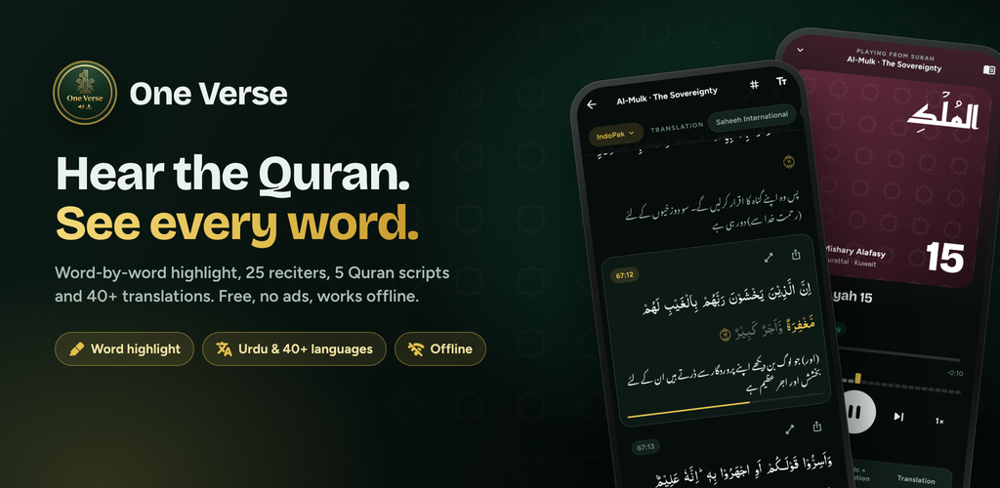

One Verse is a free, open-source Quran app built with Flutter for listening, reading and understanding, one
ayah at a time. Every word lights up as it is recited. The Quran text shows in five scripts, each in the font it
was made for. Translations come in 40+ languages, and the app keeps working offline.

There are no ads, no subscriptions and no account.

[](https://play.google.com/store/apps/details?id=com.nasihun.oneverse)

---

## 📱 Screenshots

| | | | | |
|:-:|:-:|:-:|:-:|:-:|
| 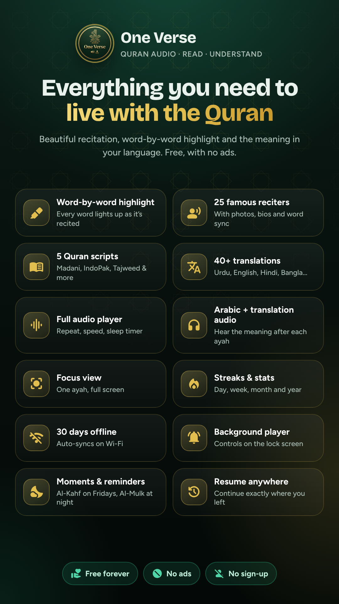 | 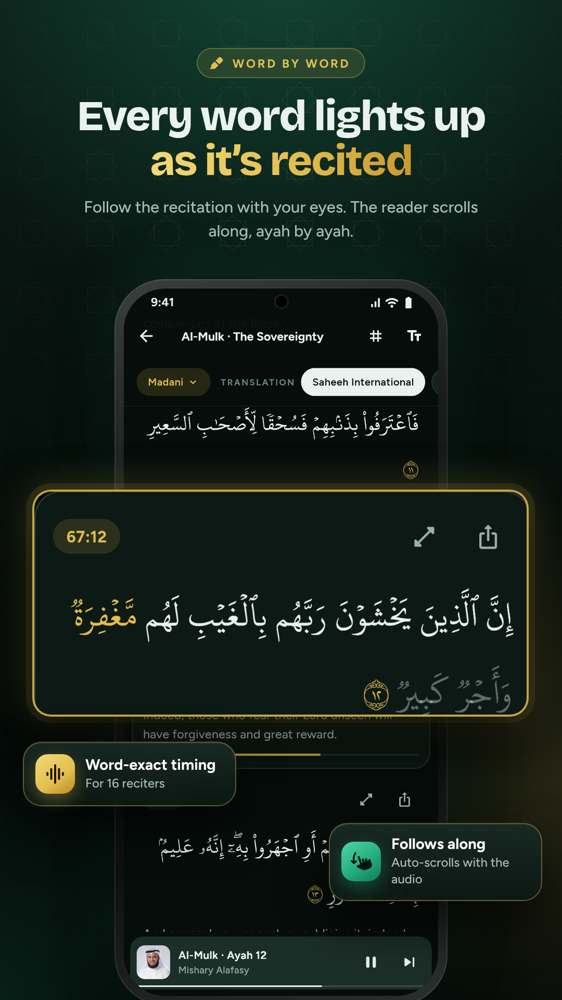 | 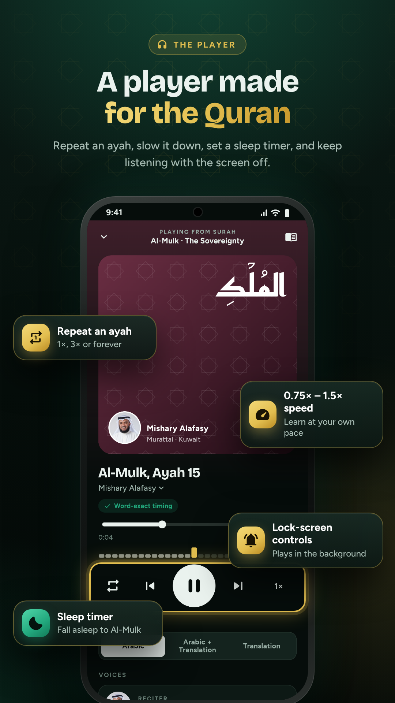 | 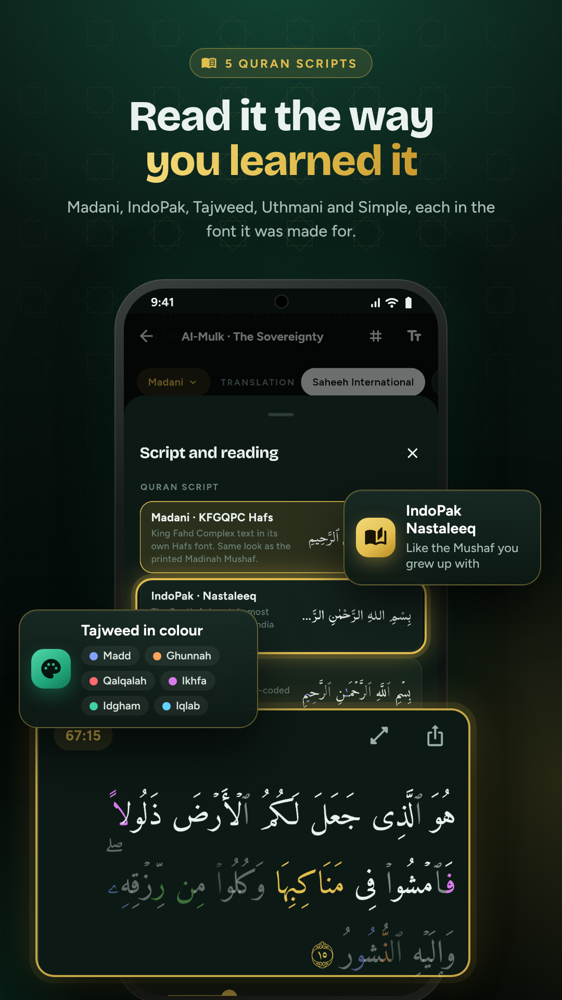 | 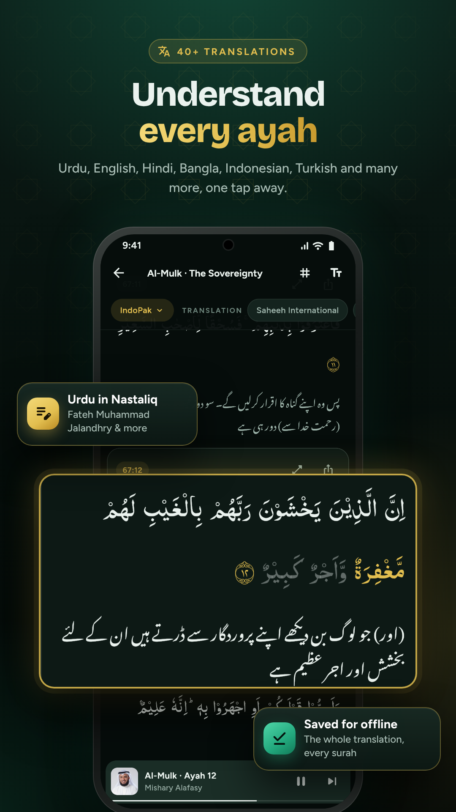 |
| 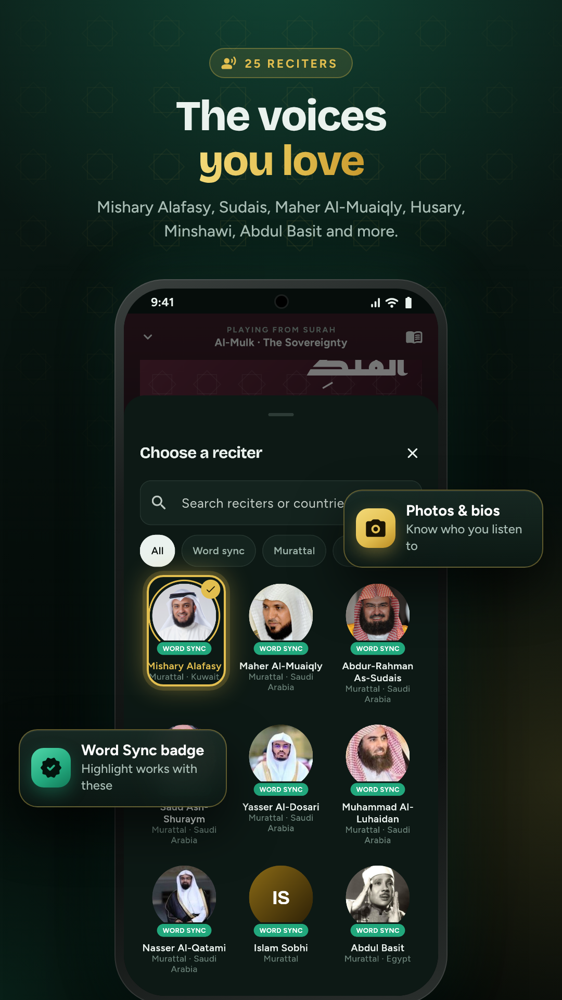 | 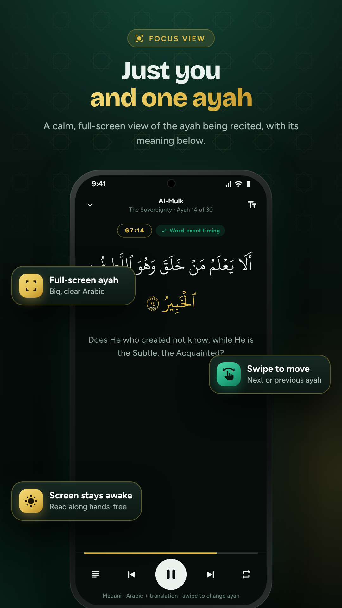 | 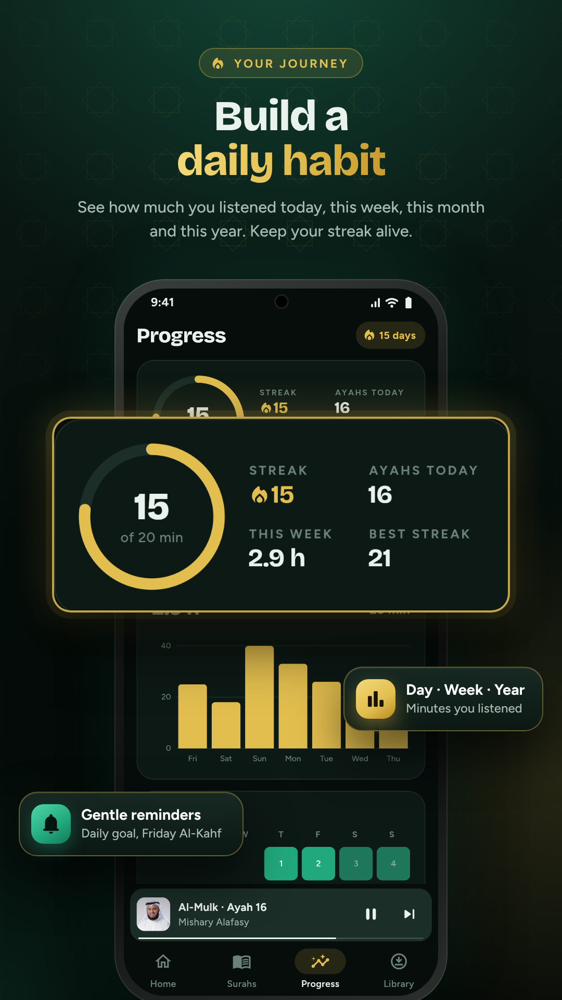 | 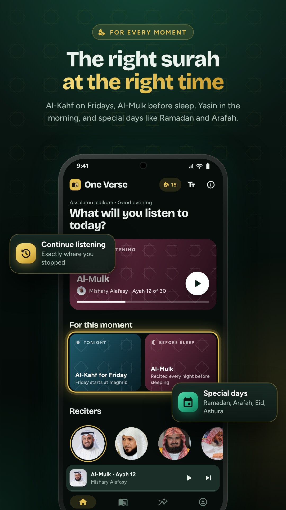 | 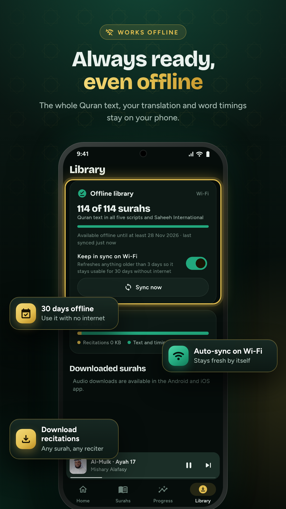 |

---

## 🌟 Features

### ✨ Word-by-word highlight
- Every word lights up exactly as the reciter says it.
- Word-exact timings exist for 16 reciters.
- The reader scrolls along with the recitation, and a "Back to ayah" button appears if you scroll away.

### 📖 Five Quran scripts, each in its own font
| Script | Text | Font |
|---|---|---|
| Madani | `text_qpc_hafs` | KFGQPC Uthmanic Hafs |
| IndoPak | `text_indopak` | IndoPak Nastaleeq |
| Tajweed colours | `text_uthmani_tajweed` | Amiri Quran, with rule colours |
| Uthmani | `text_uthmani` | Amiri Quran |
| Simple | `text_imlaei` | Scheherazade New |

Pairing each text with the font it was encoded for fixes the broken marks that Quran text often shows on
Android. See [docs/quran-scripts-and-fonts.md](docs/quran-scripts-and-fonts.md).

### 🎧 Reciters and player
- **25 reciters with photos and short biographies**, including:
  - Alafasy, Sudais, Shuraim, Maher Al-Muaiqly and Yasser Al-Dosari
  - Husary, Minshawi, Abdul Basit and Al-Qatami
- **Now Playing:**
  - repeat an ayah 1×, 3× or forever
  - speed from 0.75× to 1.5×
  - sleep timer
  - an ayah strip and an "up next" list
- **Background playback**, with controls in the notification and on the lock screen (`audio_service`).
- **Three listening modes:** Arabic, Arabic + translation audio, or translation audio only.
- **Focus view:** one ayah, full screen, with its meaning below. The screen stays on.

### 🌍 Translations
- 100+ translations in 40+ languages from AlQuran Cloud. Urdu shows in Nastaliq.
- One-tap translation chips in the reader.
- Translation audio in English, Urdu, French, Russian, Persian, Chinese and Uzbek.

### 🔥 Progress and reminders
- Minutes listened per day, week, month and year, with a daily goal ring and a calendar heatmap.
- A listening streak (our own rule: one minute a day counts).
- Reminders:
  - daily goal
  - Al-Kahf on Fridays and Al-Mulk at night
  - Hijri special days: Ramadan, the last ten nights, Arafah, both Eids, Ashura
- "For this moment" on the Home screen suggests the right surah for the time of day.

### 📶 Offline first
- The app keeps these on the phone for **30 days**:
  - the whole Quran text in all five scripts
  - your translation
  - the word timings for your reciter
- On Wi-Fi, anything older than 3 days refreshes in the background, so the 30-day window keeps moving forward.
- Any surah's recitation can be downloaded.
- Close the app or restart the phone, and One Verse opens on the same ayah with the same settings.

---

## 🛠️ Tech stack

| Area | Packages |
|---|---|
| State | [provider](https://pub.dev/packages/provider) |
| Network | [dio](https://pub.dev/packages/dio), [connectivity_plus](https://pub.dev/packages/connectivity_plus) |
| Audio | [just_audio](https://pub.dev/packages/just_audio), [audio_service](https://pub.dev/packages/audio_service), [audio_session](https://pub.dev/packages/audio_session) |
| Reminders | [flutter_local_notifications](https://pub.dev/packages/flutter_local_notifications), [timezone](https://pub.dev/packages/timezone), [flutter_timezone](https://pub.dev/packages/flutter_timezone), [hijri](https://pub.dev/packages/hijri) |
| Storage | [path_provider](https://pub.dev/packages/path_provider) (JSON cache files), [shared_preferences](https://pub.dev/packages/shared_preferences) |
| Other | [share_plus](https://pub.dev/packages/share_plus), [url_launcher](https://pub.dev/packages/url_launcher), [wakelock_plus](https://pub.dev/packages/wakelock_plus), [package_info_plus](https://pub.dev/packages/package_info_plus) |

### Data sources
| Source | Used for |
|---|---|
| [Quran.com / Quran Foundation](https://quran.com) | Word-by-word text in all scripts, word timings (QDC), chapter audio |
| [AlQuran Cloud](https://alquran.cloud) | Translations, ayah-by-ayah recitations, translation audio |
| [QuranHub (Misraj AI)](https://qurani.ai) | Reciter photos, countries and biographies |
| [Quranic Audio](https://quranicaudio.com), [mp3quran](https://mp3quran.net) | Full-surah recitations |
| [its3li/quran-word-timings](https://github.com/its3li/quran-word-timings), [baklarrrr/quran-timings](https://github.com/baklarrrr/quran-timings) | Extra word timings |

Full credits are on the in-app About screen. The research behind these choices is in [docs/](docs/README.md).

---

## 📂 Project structure

```
lib/
├── main.dart                 # Start-up: storage, network, settings, audio service, providers
├── core/theme.dart           # Colour tokens (dark and light), tajweed colours, card art, text styles
├── data/
│   ├── api.dart              # Endpoints and HTTP client with retries
│   ├── cache_store*.dart     # Offline JSON store (files on device, memory on web)
│   ├── catalog.dart          # Reciters, translation voices, quick translations
│   ├── models.dart           # Scripts, verses, timings, reciters, translations
│   ├── network.dart          # Offline / mobile data / Wi-Fi
│   ├── repository.dart       # Offline-first data and the 30-day sync policy
│   ├── offline_sync.dart     # Background prefetch of all 114 surahs on Wi-Fi
│   └── downloads.dart        # Surah recitation downloads
├── state/
│   ├── playback.dart         # Playback engine, word position, repeat, sleep, session restore
│   ├── audio_handler.dart    # Notification and lock-screen controls
│   ├── listening_log.dart    # Listening history and streak algorithm
│   ├── reminders.dart        # Scheduled reminders and Hijri special days
│   └── settings.dart         # User preferences
└── ui/
    ├── shell.dart            # Bottom navigation, mini player, resume sheet
    ├── sheets.dart           # Reciter, translation, script, sleep, jump, download sheets
    ├── screens/              # Home, Surahs, Reader, Focus, Now Playing, Progress, Library, About
    └── widgets/              # Quran text renderer, shared widgets
```

---

## 🚀 Getting started

Requirements: Flutter 3.38 or newer (Dart 3.10+), and Android Studio with Android SDK Platform 36.

```bash
git clone https://github.com/thenasihun/one-verse.git
cd one-verse
flutter pub get
flutter run
```

### Tests
```bash
flutter test test/unit_test.dart              # parsers, timings, tajweed, streaks, special days, offline policy
flutter test --tags live test/live_api_test.dart   # calls every real API (needs internet)
```

`tool/web_e2e.js` walks through every screen and all five scripts in a browser with Playwright. Run it against
the web build.

### Release build
1. Put `key.properties` and the keystore in `android/`. Both are git-ignored.
2. Build:
   ```bash
   flutter build appbundle --release
   ```
   The bundle is written to `build/app/outputs/bundle/release/app-release.aab`.

The full Play Store checklist, with release notes and listing text, is in
[PLAYSTORE_DEPLOY.md](PLAYSTORE_DEPLOY.md). The store graphics are in [store/playstore/](store/playstore/).

---

## 🤝 Contributing

Contributions are welcome. Fork the repository, create a branch, and open a pull request.

## 📄 Privacy

One Verse collects no personal data. Settings, listening history and downloads stay on your device.
[Read the privacy policy](https://nasihun.com/privacy-policy).

## ❤️ Acknowledgements

Quran.com and Quran Foundation, the King Fahd Glorious Quran Printing Complex, AlQuran Cloud, QuranHub, Quranic
Audio, mp3quran, and the open word-timing projects listed above.

Developed by [Nasihun.com](https://nasihun.com).
